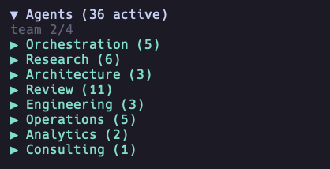
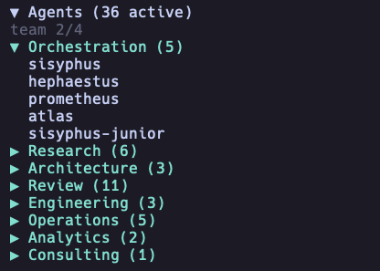
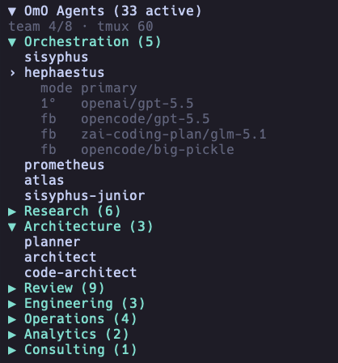

# opencode-agents-sidebar

[Русская версия](./README.ru.md)

> OpenCode v2 TUI sidebar for browsing agents and subagents from the current OhMyOpenAgent configuration source.

[](https://www.npmjs.com/package/opencode-agents-sidebar)


| Field | Value |
|---|---|
| Status | Actively maintained personal OpenCode tool/plugin |
| Type | OpenCode TUI plugin / host extension |
| Host app | OpenCode `>=2.0.32`; release smoke also covers current `2.1.2` |
| Package | `opencode-agents-sidebar` `3.0.0` |
| Runtime | Bun `>=1.3.0` |
| Maintainer checks | `bun install --frozen-lockfile && bun run typecheck && bun test && bun run build:all && bun run verify:package` |

## Screenshots

The plugin renders agent categories and details inside the OpenCode terminal UI sidebar.







## Summary

- Displays OpenCode agents in the OpenCode sidebar.
- Reads agents from `oh-my-openagent.json` through a normalized provider boundary; the seam permits a future native OpenCode source without claiming universal discovery today.
- Groups agents into neutral categories such as primary, subagents, built-in, project, global, custom, disabled, hidden, and other.
- Supports collapsible category sections and a collapsible main sidebar panel.
- Shows provider, model, variant, fallback, and disabled-agent information according to display settings.
- Supports compact and split row layouts for different terminal widths.
- Supports provider, model, and variant aliases for shorter terminal output.
- Reloads configuration through directory watches with polling recovery and deterministic fingerprint comparison.
- Handles missing or invalid configuration files with explicit sidebar states.

## Quick start

```sh
opencode plugin add opencode-agents-sidebar@3.0.0
```

## Installation

### OpenCode v2

Install the release with the v2 plugin manager:

```sh
opencode plugin add opencode-agents-sidebar@3.0.0
```

The equivalent explicit configuration is:

```jsonc
{
  "$schema": "https://opencode.ai/v2/cli.json",
  "plugins": ["opencode-agents-sidebar@3.0.0"]
}
```

Add the package once, either to `~/.config/opencode/cli.json` or to the v2
`plugins` field in `opencode.json(c)`. Package order controls v2 sidebar
contribution order.

This major does not support OpenCode v1. V1 users must pin
`opencode-agents-sidebar@1.0.8`; there is no dual-runtime compatibility shim.

### Local checkout for development

```sh
git clone https://github.com/Mark1708/opencode-agents-sidebar.git
cd opencode-agents-sidebar
bun install --frozen-lockfile
bun run build:all
bun run verify:package
```

The build emits separate v2 server and TUI definitions into `dist/`; the
package verifier writes `.artifacts/package.tgz`. Repository root shims are
intentionally absent.

## Compatibility

| Component | Supported version | Source |
|---|---|---|
| Host app | OpenCode `>=2.0.32` (smoked on `2.0.32` and `2.1.2`) | Release smoke contract |
| Plugin API | `@opencode/plugin 2.0.32` | `package.json` dependency |
| Theme API | `@opencode/theme 2.0.32` | `package.json` peer dependency |
| TUI runtime | `@opentui/core >=0.5.17`, `@opentui/solid >=0.5.17`, `solid-js 1.9.12` | `package.json` peer dependencies |
| Local runtime | Bun `>=1.3.0` | `package.json` engine |
| TypeScript | `^5.5.0` | `package.json` dev dependency |

## Configuration

The current release reads one source:

```text
~/.config/opencode/oh-my-openagent.json
```

Top-level `agents`, `agent_order`, `disabled_agents`, `team_mode`, and `tmux`
sections are OhMyOpenAgent data. `src/providers/omo.ts` normalizes that data for
the sidebar. The provider seam permits a future native OpenCode source, but
native or universal agent discovery is not part of this release.

Smallest useful configuration:

```json
{
  "tui": {
    "sidebar_width": 34,
    "name_width": 18,
    "title": "Agents"
  }
}
```

Full documented shape:

```json
{
  "tui": {
    "sidebar_width": 34,
    "name_width": 18,
    "poll_interval_ms": 2000,
    "title": "Agents",
    "category_order": ["Primary", "Subagents", "Built-in", "Project", "Global", "Custom", "Disabled", "Hidden", "Other"],
    "model_display": "details-only",
    "show_provider": true,
    "show_variant_in_details": false,
    "show_disabled": "dimmed",
    "agent_row_mode": "compact",
    "symbols": "unicode",
    "provider_aliases": {
      "openai": "oa",
      "opencode": "oc",
      "zai-coding-plan": "zai"
    },
    "model_aliases": {
      "gpt-5.4-mini-fast": "gpt-5.4mf",
      "gpt-5.4-mini": "gpt-5.4m",
      "gpt-5.5": "5.5",
      "glm-4.5-air": "glm-4.5a"
    },
    "variant_aliases": {
      "medium": "M",
      "high": "H",
      "xhigh": "XH"
    }
  }
}
```

When using the current OhMyOpenAgent bootstrap source, keep a legacy category order if you want the familiar grouping:

```json
{
  "tui": {
    "title": "Agents",
    "category_order": ["Orchestration", "Research", "Architecture", "Review", "Engineering", "Operations", "Analytics", "Consulting", "Other"]
  }
}
```

Supported values:

- `model_display`: `"inline"`, `"details-only"`, or `"hidden"`.
- `show_disabled`: `"hidden"`, `"dimmed"`, or `"grouped"`.
- `agent_row_mode`: `"compact"` or `"split"`.
- `symbols`: `"unicode"` or `"ascii"`.

OpenCode v2 sidebar contribution order follows package order in the host
`plugins` list.

## Usage

- Start OpenCode with the plugin installed.
- The sidebar appears on the right side of the TUI.
- Click the main header to collapse or expand the full sidebar.
- Click category headers to collapse or expand provider groups.
- Click an agent row to show model, variant, and fallback details.
- Tune width, model display, aliases, and symbol mode in provider metadata/config.

## Agent categories

The default product categories are neutral OpenCode/provider categories from `src/defaults.ts`:

| Category | Examples |
|---|---|
| Primary | Main OpenCode agents when the native provider lands |
| Subagents | OpenCode subagents when the native provider lands |
| Built-in | Built-in host agents |
| Project | Project-local agents |
| Global | User-level agents |
| Custom | Custom provider agents |
| Disabled | Disabled agents when grouped |
| Hidden | Reserved for providers that expose hidden entries |
| Other | Agents not mapped to a known category |

The temporary OhMyOpenAgent bootstrap provider keeps its legacy lifecycle mapping inside `src/providers/omo.ts` so it does not become the generic product model.

## Display options

By default, the sidebar uses `agent_row_mode: "compact"` with `model_display: "details-only"`. That means the agent list stays focused on names, while the selected agent shows model details below the row.

The runtime display includes the main header, optional team status line, expanded or collapsed categories, details-only agent rows, and selected agent details:

```text
▼ Agents (33 active)
team 2/4
▼ Custom (5)
› local-helper
    mode primary
    source custom
    1°   zai-coding-plan/glm-5.1
    fb   openai/gpt-5.5
    fb   opencode/big-pickle
  reviewer
  planner
▶ Other (3)
```

- `agent_row_mode`: `"compact"` keeps each agent on one row. `"split"` uses two rows when `model_display` is `"inline"`.
- `model_display`: `"details-only"` shows provider and model details only for the selected agent. `"inline"` shows model information in the agent row. `"hidden"` hides model information from rows and details.

## Project structure

```text
.
├── assets/                    # Local screenshots used by this README
├── dist/                      # Built package output
├── src/
│   ├── agents/                # Normalized agent types, grouping, merge logic
│   ├── providers/             # AgentProvider boundary and OhMyOpenAgent source
│   ├── agents.ts              # Agent list/view-state helpers
│   ├── config.ts              # Raw JSON reading and sidebar config merge helpers
│   ├── config-watcher.ts      # Directory watches with polling recovery
│   ├── runtime.ts             # Runtime states, fingerprints, serialized reloads
│   ├── defaults.ts            # Neutral sidebar defaults
│   ├── format.ts              # Text formatting and display utilities
│   ├── index.ts               # OpenCode v2 server definition
│   ├── render.ts              # Sole OpenTUI/Solid render boundary
│   ├── tui.ts                 # OpenCode v2 lifecycle and state ownership
│   └── types.ts               # TypeScript type definitions
├── package.json               # Package metadata, scripts, peer dependencies
├── tsconfig.json              # TypeScript configuration
└── LICENSE
```

## Troubleshooting

- If the package does not load, run `opencode plugin check` and verify that `opencode-agents-sidebar@3.0.0` appears once in the v2 `plugins` list.
- If a local build does not load, run `bun run build:all && bun run verify:package` and test `.artifacts/package.tgz` through a disposable v2 wrapper.
- If agents do not appear, verify `~/.config/opencode/oh-my-openagent.json` contains valid agent metadata.
- Missing and malformed configuration produce explicit sidebar states and recover after create, replace, or edit.
- If content is cut off, adjust `sidebar_width`, `name_width`, or `agent_row_mode`.
- If model names are too long, use `model_aliases`, `provider_aliases`, or `variant_aliases`.
- If config changes do not appear, verify the configured path is readable; native directory watching falls back to polling after watch errors.

## Limitations / Security

- The plugin reads local OhMyOpenAgent metadata, not provider credentials. Native OpenCode agent discovery is a future provider implementation.
- Config reload uses directory watchers with polling recovery, deterministic fingerprints, and generation-gated serialized reads.
- Sidebar width behavior is constrained by terminal and OpenCode TUI rendering.
- Styling depends on the host OpenCode and OpenTUI theme capabilities.
- Example configuration values are placeholders and can be adjusted per local setup.

## Status

Actively maintained personal OpenCode tool/plugin. Public issues and improvements are welcome, but the project is primarily maintained around the author's own workflow.

## Links / License

- Package: <https://www.npmjs.com/package/opencode-agents-sidebar>
- Repository: <https://github.com/Mark1708/opencode-agents-sidebar>
- Host app: <https://opencode.ai/>
- Listed under Plugins in the curated [awesome-opencode](https://github.com/awesome-opencode/awesome-opencode) directory.
- License: MIT, see [`LICENSE`](LICENSE)
